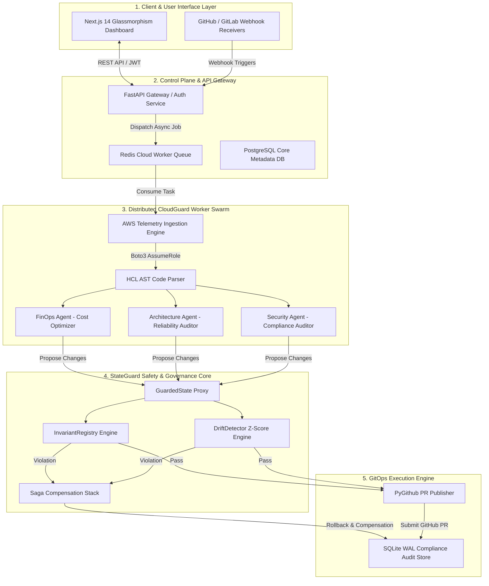

# 🏛️ System Architecture & System Design Document
## Project: CloudGuard FinOps Engine (Powered by StateGuard)

---

## 1. Executive Summary & Design Philosophy

**CloudGuard FinOps** is an enterprise-grade, event-driven multi-agent platform designed to continuously audit cloud infrastructure (AWS/GCP), identify wasted spend, and remediate cost inefficiencies by automatically generating and opening **Terraform Pull Requests** on GitHub/GitLab.

### Core Design Principles
1. **Zero-Trust Cloud Security:** CloudGuard operates exclusively on **Read-Only IAM Permissions** (`Describe*`, `Get*`, `ce:*`). The platform *never* requests or holds cloud write access.
2. **Deterministic Agent Governance:** Powered by **StateGuard**, all AI agent execution is governed by transactional memory proxies, pre-commit business invariants, statistical drift detection, and automated Saga rollbacks.
3. **Shift-Left GitOps Remediation:** Rather than sending passive alerts, infrastructure changes are delivered as human-reviewable, syntax-validated Pull Requests.

---

## 2. Capacity Planning & Back-of-the-Envelope Math

To ensure the system scales smoothly to 1,000+ customer AWS accounts, we establish the following baseline estimations:

### 2.1 Scale Assumptions
- **Active Accounts ($N$):** 1,000 customer AWS Accounts.
- **Resources per Account ($R$):** ~500 active resources (EC2, RDS, EBS, ElastiCache).
- **Terraform Repositories ($G$):** 1,500 GitHub repos containing ~10,000 `.tf` files.
- **Daily Scans:** 1 scan/account/day = 1,000 full execution runs / day.

### 2.2 Throughput & Storage Estimations
- **CloudWatch Metric Queries:** $1,000 \text{ accounts} \times 500 \text{ resources} = 500,000 \text{ metric queries/day}$.
  - At 86,400 seconds/day $\approx$ **5.8 API requests/sec** (well within AWS CloudWatch rate limits of 500 req/sec).
- **PostgreSQL Database Storage:**
  - `pull_request_logs`: 100 PRs/day $\times$ 2 KB/row $\times$ 365 days $\approx$ **73 MB/year**.
  - Extremely lightweight relational footprint.
- **StateGuard Audit Trail (SQLite WAL):**
  - 1,000 scans/day $\times$ 50 events/scan $\times$ 1 KB/event $\approx$ **50 MB/day** $\rightarrow$ **18 GB/year** (archived to S3 cold storage monthly).

---

## 3. High-Level Architecture & Component Map



---

## 4. Component Deep Dive

### 4.1 Telemetry Ingestion Service (`src/services/aws_collector.py`)
- **Authentication:** Executes `boto3.client('sts').assume_role()` against customer's `CloudGuardReadOnlyRole`.
- **CloudWatch Telemetry Fetcher:** Queries 90-day time-series telemetry (`CPUUtilization`, `FreeableMemory`, `WriteIOPS`) using 1-day aggregation buckets.
- **Resiliency:** Implements exponential backoff with jitter to handle AWS API throttling (`RequestLimitExceeded`).

### 4.2 HCL AST Parser & Code Mutator (`src/services/hcl_parser.py`)
- **AST Parsing:** Uses `python-hcl2` to convert HCL `.tf` files into Python dictionaries without executing arbitrary code.
- **Code Mutation:** Implements precise regex boundary replacements that update target resource attributes (e.g. `instance_class = "db.r6g.xlarge"`) while ignoring lines starting with `#` or `//`.

### 4.3 Multi-Agent Consensus Swarm (`src/agents/`)
- **FinOps Agent:** Evaluates AWS Global Pricing API catalogs to propose the lowest-cost instance tier (e.g., Graviton `t4g`/`r6g` migration).
- **Architecture Agent:** Evaluates 99th-percentile CloudWatch peak metrics to enforce safe performance headroom ($\text{RAM}_{\text{proposed}} \ge \text{RAM}_{\text{peak}} \times 1.25$).
- **Security Agent:** Verifies SOC 2 compliance tags, KMS storage encryption flags, and public exposure risks.

### 4.4 StateGuard Governance Core (`src/governance/`)
Wraps the agent execution state in transactional memory proxy:
- **`GuardedState`:** Provides nested $O(1)$ snapshots (`begin()`, `commit()`, `rollback()`).
- **`InvariantRegistry`:** Pre-commit boolean assertions.
- **`DriftDetector`:** Calculates statistical Z-Scores on cost deltas ($Z > 3.5 \rightarrow \text{Abort}$).
- **`SagaCoordinator`:** Executes LIFO compensation functions if a multi-file PR workflow encounters an error mid-execution.

---

## 5. Sequence Diagram: End-to-End Scan & PR Generation

```mermaid
sequenceDiagram
    autonumber
    participant Schedule as Job Scheduler
    participant Collector as AWS Telemetry Engine
    participant Parser as HCL Code Parser
    participant Swarm as Multi-Agent Swarm
    participant Guard as StateGuard Engine
    participant GitHub as GitHub API

    Schedule->>Collector: Trigger Daily Account Scan
    Collector->>Collector: STS AssumeRole (Read-Only IAM)
    Collector->>Collector: Query CloudWatch 90-day CPU/RAM Telemetry
    Collector->>Parser: Fetch .tf files & parse HCL AST
    Parser->>Swarm: Send Telemetry + Resource AST
    Swarm->>Swarm: FinOps vs Arch Agent Consensus Debate
    Swarm->>Guard: Submit Proposed Mutation State
    Guard->>Guard: Evaluate Invariants (CPU < 80%, RAM Buffer)
    Guard->>Guard: Evaluate DriftDetector Z-Score
    alt Validation Passed
        Guard->>GitHub: Create Branch & Submit Terraform PR
        GitHub-->>Schedule: PR Opened Successfully
    else Invariant / Drift Violation
        Guard->>Guard: Rollback Memory Snapshot & Execute Saga
        Guard-->>Schedule: Abort & Log Violation to Audit Store
    end
```



---

## 6. Database Schema Design

### 6.1 PostgreSQL Relational Model

```sql
-- Customer Accounts
CREATE TABLE customers (
    id UUID PRIMARY KEY DEFAULT gen_random_uuid(),
    email VARCHAR(255) UNIQUE NOT NULL,
    company_name VARCHAR(255) NOT NULL,
    created_at TIMESTAMP WITH TIME ZONE DEFAULT CURRENT_TIMESTAMP
);

-- AWS Accounts (Cross-Account IAM Roles)
CREATE TABLE aws_accounts (
    id UUID PRIMARY KEY DEFAULT gen_random_uuid(),
    customer_id UUID REFERENCES customers(id) ON DELETE CASCADE,
    aws_account_id VARCHAR(12) NOT NULL,
    role_arn VARCHAR(255) NOT NULL,
    external_id VARCHAR(255) NOT NULL,
    status VARCHAR(50) DEFAULT 'connected',
    created_at TIMESTAMP WITH TIME ZONE DEFAULT CURRENT_TIMESTAMP
);

-- Pull Request Logs
CREATE TABLE pull_request_logs (
    id UUID PRIMARY KEY DEFAULT gen_random_uuid(),
    aws_account_id UUID REFERENCES aws_accounts(id) ON DELETE CASCADE,
    github_pr_number INT NOT NULL,
    github_pr_url VARCHAR(500) NOT NULL,
    resource_id VARCHAR(255) NOT NULL,
    old_spec VARCHAR(100) NOT NULL,
    new_spec VARCHAR(100) NOT NULL,
    monthly_savings_usd NUMERIC(10, 2) NOT NULL,
    status VARCHAR(50) DEFAULT 'open',
    stateguard_trace_id VARCHAR(255) NOT NULL,
    created_at TIMESTAMP WITH TIME ZONE DEFAULT CURRENT_TIMESTAMP
);
```

---

## 7. Security & Compliance Architecture

1. **Zero AWS Secret Keys:** We store **zero** AWS secret keys in our databases. We store only Customer Role ARNs and unique `ExternalId` tokens.
2. **Path Traversal Protection:** All file paths are sanitized via `src/utils/security.py:sanitize_file_path()`.
3. **IAM Role ARN Filtering:** All Role ARNs are validated against regex `arn:aws[a-z-]*:iam::\d{12}:role/...`.
4. **Data at Rest & Transit:** All database columns storing tokens are encrypted with AES-256-GCM. All HTTP API traffic uses TLS 1.3.

---

## 8. Failure Recovery & Circuit Breakers

- **GitHub Rate Limiting:** Managed via token bucket queue. If GitHub API rate limits drop below 100 requests, worker auto-pauses until `X-RateLimit-Reset`.
- **AWS API Throttling:** Handled by `botocore` adaptive retries with exponential backoff.
- **State Failure:** StateGuard `Saga` ensures zero orphan branches or bad commits on multi-step workflows.
